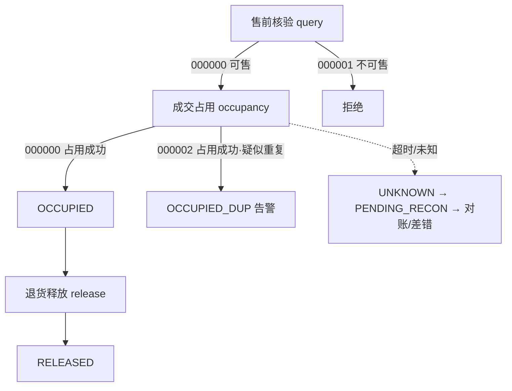

# 业务架构 v1.0

## 业务流程

## 领域模型
SN（regionCd+snCode 唯一）→ 状态机（NEW/SALEABLE/NOT_SALEABLE/OCCUPYING/OCCUPIED/OCCUPIED_DUP/RELEASING/RELEASED/UNKNOWN/PENDING_RECON）；订单 orderId 仅在占用态携带；释放按 regionCd+snCode 反查原订单。

## 不变量
1. 同一 SN 同时至多一个 OCCUPIED（乐观锁版本 + 幂等键）。
2. 验签通过才进业务处理。
3. UNKNOWN 不自动重发占用。
4. 审计不含敏感明文。
5. 银联不可用 fail-closed（合规优先）。
