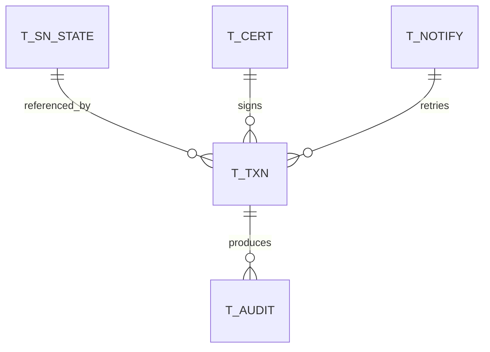

# 数据架构 v1.0（ER / 索引 / 迁移 / 分级）

## ER

## 表
| 表 | 主键/索引 | 关键字段 |
| --- | --- | --- |
| t_txn | idem_key UK, idx(req_id), idx(trace_id), idx(day_cut) | appId, orderId, regionCd, snCode, state, up_code, up_sub_code, retry_cnt |
| t_sn_state | UK(region_cd, sn_code), version 乐观锁 | cateCd, actId, orderId, mchntCd, state |
| t_cert | PK(sign_id), idx(not_after) | certType, pem, notBefore/After, status, overlapWith |
| t_notify | PK(task_id), idx(next_fire_at) | attempt, max=5, dayCutDeadline |
| t_audit | idx(trace_id), idx(ts) | headers_sanitized, body_sanitized, result（无签名串原文/敏感明文） |

## 迁移策略
- 沙箱：createMemoryStores()，零迁移。
- 落地：createFileStores(dir) JSON 原子写（tmp+rename）；上生产时按 t_* 建关系表，DDL 由后端经理审查后执行（brief 要求迁移脚本先审）。
- 版本：contract.js 为契约源，表结构变更走 CR 并同步本文件。

## 数据安全分级（S/A/B/C，派活时必须转达实现域）
| 级别 | 字段 | 处置 |
| --- | --- | --- |
| S | snCode, imei1, imei2, addr, gps, encryptData.key, 私钥 | encryptData 信封 + 全掩码 + HMAC 检索索引 |
| A | orderId, mchntCd, signId | 部分掩码 |
| B | regionCd, cateCode, txnAmt | 明文 |
| C | 其余 | 明文 |
