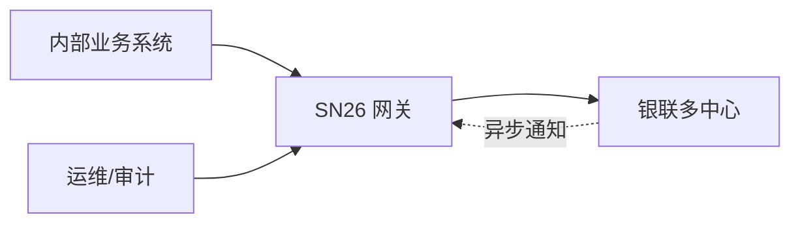

# 系统架构 v1.0（C4）

## 上下文

## 容器
| 容器 | 文件 | 职责 |
| --- | --- | --- |
| 北向接入 | src/north/server.js | 鉴权、租户、限流、REST/管理面 |
| 业务编排 | src/core/orchestrator.js | 一次完整请求生命周期 |
| 协议适配 | src/protocol/adapter.js, response.js | DTO↔数据元、应答归一化 |
| 安全密码服务 | src/crypto/provider.js + sm2/sm3/sm4 | 签名验签、encryptData、证书库 |
| 传输 | src/transport/client.js, filechannel.js | 多中心、gzip、超时、批量文件 |
| 存储 | src/core/store.js, state.js, reconcile.js | 五存储、状态机、对账/存储转发 |
| Mock 银联 | src/mock/server.js | M0 沙箱（含验签/chaos） |
| 反向接入 | src/inbound/server.js | 证书更新应答、异步通知 200/302 |
| 可观测 | src/observability/metrics.js | 指标与告警 |

## 关键决策（ADR）
- ADR-1 运行时 node:crypto 无 SM2/SM3/SM4 → 纯 JS 实现 + 标准向量与 n·G=∞ 自洽校验；否决「引入 npm 国密库」（零依赖约束）。
- ADR-2 签名与线上 body 一次序列化复用；否决「先签名再改 JSON」。
- ADR-3 验签证书库 map<signId,cert> 而非单例；支持 3 个月新旧并行。
- ADR-4 UNKNOWN 不自动重发 occupancy（规范无占用状态查询接口），转 PENDING_RECON；否决盲目重试。
- ADR-5 A13 批量文件真实实现（≤10M 内联 / >10M SFTP 暂存），否决「本期不做」。
